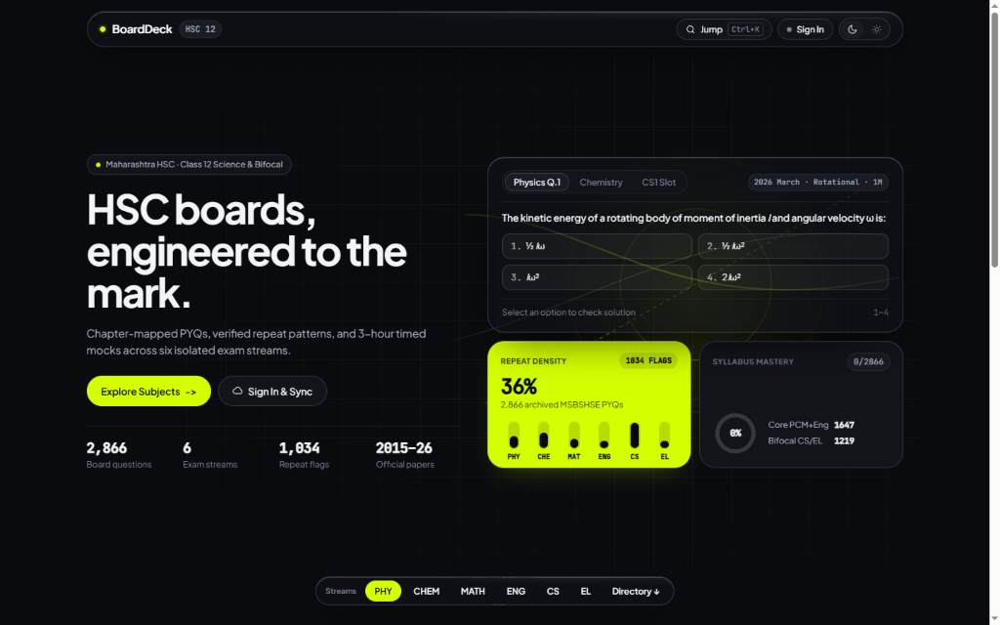

# BoardDeck — HSC Class 12 PYQ & Mock Exam Workspace

**Live app:** [boardeck.vercel.app](https://boardeck.vercel.app)

BoardDeck is a static, offline-first revision workspace built for Maharashtra State Board (MSBSHSE) Class 12 Science students. Compulsory Science papers (`Physics`, `Chemistry`, `Mathematics`, `English`) and Bifocal electives (`Computer Science D-9`, `Electronics C-2`) stay strictly isolated with their own chapter trees, weightage tables, past papers, review queues, and timed mock exams.



## Why I built this

Preparing for Maharashtra HSC Class 12 boards usually means juggling scattered PDFs, broken textbook-back links, and solutions that spoil the answer before you even attempt the question. I built BoardDeck for myself and my classmates so every chapter-mapped PYQ, repeat frequency flag, and 3-hour mock paper lives in one fast workspace that works on both laptop and phone without losing progress.

## Covered Subjects (2,866 Questions · 1,034 Repeat Flags)

| Group | Subject | Code | Coverage | Count |
| --- | --- | --- | --- | --- |
| Core | Physics | `54` | 2022–2026 Revised Syllabus · 8 papers | 442 Qs |
| Core | Chemistry | `55` | 2022–2026 Revised Syllabus · 8 papers | 581 Qs |
| Core | Mathematics & Statistics | `40` | 2022–2026 Revised Syllabus · 8 papers | 357 Qs |
| Core | English | `01` | Prose, Poetry, Writing Skills (`Q.4`), Novel | 267 Qs |
| Bifocal | Computer Science | `D-9` | 2015–2026 structured + scan links | 963 Qs |
| Bifocal | Electronics | `C-2` | Applied & Digital Electronics · SVG circuits | 256 Qs |

## Key Features

- **Hidden answers by default:** Attempt MCQs first for immediate verification or press `R` to reveal full step-by-step solutions.
- **Paper-slot strategy:** Maps chapter marks and exam shortcuts (such as CS1 `Q.5` HTML vs C++ pairing and English `Q.4` writing templates).
- **Timed mock exams:** Sorts each past paper in original paper order with a 3-hour countdown and separate mock state.
- **Keyboard navigation:** `J` / `K` move across cards, `1–4` answer MCQs, `R` toggles answers, `M` marks mastered, `F` queues review, and `Ctrl+K` opens quick chapter jump.
- **Cloud Sync + Offline Guest mode:** Persists locally in `localStorage` out of the box and syncs across devices via Google Sign-In (Supabase Auth + Postgres Row Level Security).

## Design Decisions

- **Static shell + lazy-loaded JSON per subject:** Instead of bundling all 2,866 questions (~5 MB) upfront or paying for a backend API, `data/manifest.json` (~40 KB) boots the landing screen immediately and fetches `data/<stream>.json` only when a student opens that subject.
- **Offline-first `localStorage` with timestamped merge sync:** Studying on a bus or in a classroom shouldn't require a login or internet connection. Every attempt writes to `localStorage` immediately; when signed in via Supabase, client and cloud states merge by per-question/per-subject timestamps instead of blindly overwriting.
- **Desktop-only WebGL header refractor (`liquidGL.js`):** The liquid glass header effect loads lazily only on desktop viewports so mobile devices incur zero WebGL/shader overhead.
- **MathJax 3 formula & code isolation:** Configured with `input/tex`, `input/asciimath`, and `mhchem` while explicitly skipping `<pre>` and `<code>` tags so C++, HTML, and 8085 Assembly snippets render untouched alongside integrals and chemical equations.

## Previews

| Overview & Slot Strategy | Chapter Drill (MathJax & Solutions) |
| --- | --- |
|  |  |

## Sources & Disclaimer

- **Official Question Papers:** All Maharashtra HSC Class 12 past board question papers and syllabi belong to the **Maharashtra State Board of Secondary and Higher Secondary Education (MSBSHSE)**.
- **Paper & Solution References:** Structured questions, solutions, and scan links are compiled from public MSBSHSE past paper archives and [Shaalaa](https://www.shaalaa.com/) for non-commercial student revision. If you spot an error in any question, chapter tag, or solution, please [open an issue](https://github.com/siddongare/boarddeck/issues/new).

## Known Limitations

- **Client-side dataset search:** Search and filtering run in-memory per active subject rather than globally across all 2,866 questions at once.
- **External diagram & scan links:** Some Physics, Electronics, and older CS scan references link to external image/archive URLs that require an active connection.
- **No automated browser E2E in CI yet:** GitHub Actions validates every `data/*.json` schema and JS syntax on push; UI flows are currently verified manually/via Playwright locally.

## Roadmap

- [ ] Add global cross-subject search in `Ctrl+K`
- [ ] Bundle critical circuit/optics diagrams locally to remove external image dependencies
- [ ] Add automated two-account Supabase RLS integration check & mobile Lighthouse budget

## Running Locally & Validation

Because `data/*.json` files load over `fetch()`, run a local static server from the repo root:

```bash
python -m http.server 8000
```

Then visit `http://localhost:8000/`.

To validate all 2,866 questions across `data/*.json` (required fields, duplicate UIDs, chapter/section references, MCQ indices) and check JS syntax:

```bash
node scripts/validate-data.mjs
node --check assets/app.js
node --check assets/sync.js
```

## Cloud Sync & Vercel Setup (Deployment Note)

1. In Supabase, open **SQL Editor** and run [`supabase_schema.sql`](supabase_schema.sql) to create the `boarddeck_profiles` table and Row Level Security policies.
2. In Supabase -> **Authentication -> URL Configuration**, add `https://boardeck.vercel.app/**` to **Redirect URLs** and set **Site URL** to `https://boardeck.vercel.app`.
3. Link Supabase to Vercel via **Supabase -> Settings -> Integrations -> Vercel -> Add new project connection** (or set `NEXT_PUBLIC_SUPABASE_URL` and `NEXT_PUBLIC_SUPABASE_ANON_KEY` in Vercel Environment Variables). During build, [`scripts/inject-env.mjs`](scripts/inject-env.mjs) writes those public config values into `assets/supa-env.js` automatically.
4. Enable **Web Analytics** in the Vercel dashboard (`/_vercel/insights/script.js` is already wired in [`index.html`](index.html)).

## Repository Structure

```text
.
├── .github/workflows/
│   └── validate-data.yml  # CI: JSON schema/UID validation & JS syntax check
├── assets/
│   ├── app.js             # Client state, lazy JSON loader, filters, mock engine, sync hooks
│   ├── liquidGL.js        # Lazy-loaded desktop-only WebGL header refractor (0 mobile overhead)
│   ├── styles.css         # Dark/light theme tokens, Acid-Lime accents, mobile bottom nav
│   ├── supa-env.js        # Public Supabase endpoint stub (updated on Vercel build)
│   └── sync.js            # Supabase Auth, timestamped merge, debounced cloud push
├── data/
│   ├── manifest.json      # Lightweight index across all 6 streams
│   └── *.json             # Isolated subject datasets (phy, chem, math, eng, cs, el)
├── scripts/
│   ├── inject-env.mjs     # Vercel build script writing public env vars to assets/supa-env.js
│   └── validate-data.mjs  # Schema, duplicate-ID & reference validator for data/*.json
├── index.html             # Application shell, MathJax 3 config & Vercel Analytics
├── supabase_schema.sql    # Postgres schema, RLS policies & updated_at trigger
└── vercel.json            # Static routing, clean URLs & build hook
```
