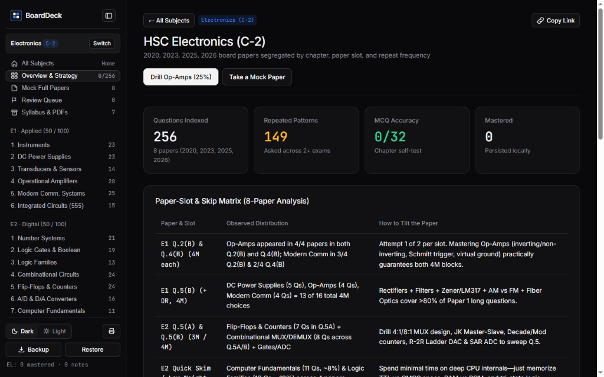
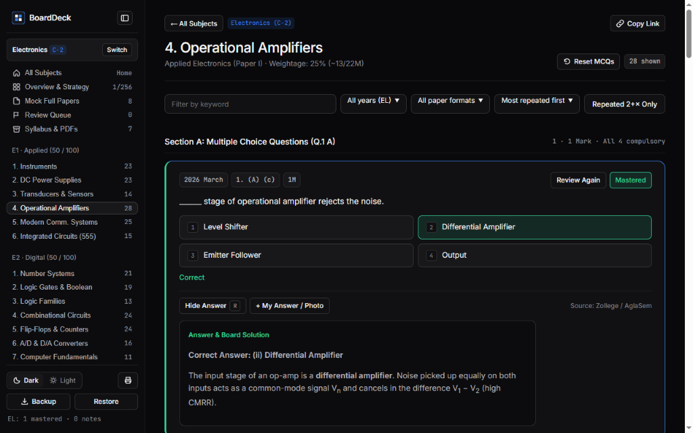

<p align="center">
  
</p>

<h1 align="center">BoardDeck · HSC Class 12</h1>

<p align="center">
  Maharashtra HSC (MSBSHSE) board PYQ workspace for <strong>Computer Science (D-9)</strong> and <strong>Electronics (C-2)</strong>.<br />
  <a href="https://hsc-cs.vercel.app"><strong>hsc-cs.vercel.app</strong></a>
</p>

---

## Why I built this

Most HSC board prep tools dump unorganized PDFs or force CS and Electronics students onto mixed pages. During Class 12 prep (especially while juggling JEE or CET), you do not have time to guess which chapters actually fill `Q.2(B)`, `Q.4(B)`, or `Q.5`.

**BoardDeck** separates each subject into its own isolated workspace—chapters, paper-slot strategies, repeat frequencies, timed mock papers, review queues, and personal notebook notes stay strictly scoped per stream.

---

## Covered Subjects (1,219 Questions Total)

### Computer Science · Code D-9 (`963` Questions · `24` Papers)
- **Coverage:** 2015–2026 March & July CS1 & CS2 papers sourced from Shaalaa, plus links to 2011–2014 scanned papers.
- **CS1 Chapters:** Operating System, Data Structures, C++ Programming, HTML (Web Designing).
- **CS2 Chapters:** 8085 Microprocessor Org, 8085 Instruction Set & ALP, Intel x86 Family, 8051 Microcontroller, Networking Technology.
- **Slot Edge:** `Q.5` (10M compulsory out of 15M) has always been 2 C++ programs + 1 HTML page (`45` C++ and `24` HTML across 12 CS1 papers). In CS2, `71/72` Q.5 questions are 8085 Assembly programs.

### Electronics · Code C-2 (`256` Questions · `8` Papers)
- **Coverage:** 2020 March (`V-233` / `V-267`), 2023 March (`V-553` / `V-587`), 2025 March (`V-53` / `V-87`), and 2026 March (`V-733` / `V-767`) sourced from official MSBSHSE PDFs via AglaSem, Zollege, Collegedunia, TechNiyojan, and Vidyasagar Academy (Shaalaa currently hosts syllabus only for Electronics).
- **Paper I (Applied Electronics):** Instruments, DC Power Supplies, Transducers & Sensors, Operational Amplifiers, Modern Comm. Systems, Integrated Circuits (555).
- **Paper II (Digital Electronics):** Number Systems, Logic Gates & Boolean Algebra, Logic Families, Combinational Circuits, Flip-Flops & Counters, A/D & D/A Converters, Computer Fundamentals.
- **Slot Edge:** In Paper I, Operational Amplifiers appeared in `4/4` indexed papers in both `Q.2(B)` and `Q.4(B)` 4M blocks. In Paper II, Flip-Flops + Combinational Circuits (MUX/DEMUX) + ADC/DAC dominate `Q.5(A)` and `Q.5(B)`.

---

## Features

- **Strict Subject Isolation:** Pick CS or Electronics on the landing page. Switching streams never bleeds filters, chapters, mock dropdowns, or review queues.
- **Interactive Active Recall:** MCQs let you guess first before grading; derivations and circuit answers stay collapsed behind a reveal toggle (`R`).
- **Repeat Detection (`Asked Nx`):** Conceptually matching questions across distinct exam years are clustered so high-frequency patterns sort first.
- **Isolated Mock Mode:** Timed 3-hour full board papers sorted strictly `Q.1 -> Q.5` without leaking chapter mastery.
- **Personal Notes & Photo Uploads:** Save concise board answers or notebook photos right inside any card (`localStorage`), with JSON backup/restore.

<p align="center">
  
  
</p>

<p align="center">
  
</p>

---

## Keyboard Shortcuts

- `J` / `K` — Next / previous question
- `R` — Reveal / hide solution
- `1`–`4` — Pick MCQ option
- `M` — Mark Mastered
- `F` — Flag for Review Queue

---

## Local Setup

Static single-page build (`index.html`, zero runtime dependencies):

```bash
git clone https://github.com/siddongare/hsc-cs.git
cd hsc-cs
python -m http.server 8000
```

Then open `http://localhost:8000`. Progress stays in browser `localStorage` under `boarddeck_hsc_v1` (existing `hsc_cs_trainer_v3`/`v2` saves migrate automatically).

---

## Attribution & License

Question text, schematics, and solution references belong to MSBSHSE and their respective open archives (Shaalaa, AglaSem, Zollege, Collegedunia, TechNiyojan, and Vidyasagar Academy). Built purely as a personal non-commercial revision workspace. Code licensed under the [MIT License](LICENSE).
